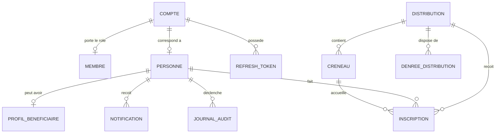

# Modèle de données - Solivio

> Comment les fonctions du produit se traduisent en entités, attributs et relations, pour la V1, en anticipant la suite.

**Document structurant - version 1.2**
**Statut : référence de travail**
**Dernière mise à jour : octobre 2026**

> Changements de la version 1.2 (octobre 2026) : une seule association et un seul schéma (ADR-001) ; l'identité de connexion (`compte`) et le rôle (`membre`) remplacent Keycloak, `identifiants_connexion`, `role`, `permission`, `role_permission` et `affiliation` ; le modèle reflète désormais les migrations Flyway réelles (`solivio-api/src/main/resources/db/migration`).

> Changements de la version 1.1 : (1) le profil bénéficiaire passe d'un champ json à des champs définis et typés (date de naissance, statut boursier, nationalité, reste à vivre, niveau académique, logement...) ; (2) la distribution gère deux modes de créneau au choix de l'association (créneau unique premier-arrivé-premier-servi, ou créneaux découpés par horaire).

## Avertissement de lecture

Ce document décrit le modèle de données de Solivio à un niveau **logique** : les entités, leurs attributs principaux, et leurs relations. Il ne descend pas au niveau physique (types exacts, index, partitionnement, choix du moteur), qui relève de `architecture_technique.md`.

Trois disciplines le gouvernent :

1. **La V1 d'abord.** Les entités nécessaires à la V1 sont modélisées en détail. Les entités des versions ultérieures sont décrites plus brièvement, uniquement pour vérifier que le modèle V1 ne leur ferme pas la porte.
2. **Anticiper sans construire.** Conformément à l'engagement pris dans les spécifications fonctionnelles, le modèle est conçu pour accueillir plus tard les stocks, les dons et surtout la hiérarchie multi-antennes, sans réécriture. Anticiper la structure n'est pas la construire.
3. **La confidentialité par conception.** La séparation des données sensibles des bénéficiaires est inscrite dans le modèle lui-même, pas ajoutée après coup.

Convention de nommage : les noms techniques des entités et des champs sont en français sans accents (par exemple `creneau`, `denree_distribution`), pour rester lisibles par tous et compatibles avec les contraintes techniques. Le choix définitif de la convention (français ou anglais) est un point d'implémentation laissé à `architecture_technique.md`.

## 1. Principes de modélisation

**M1 - Conception par le domaine.** Le modèle part des concepts métier (une association, une personne, une distribution, une denrée), pas des écrans ni des tables techniques. C'est l'application du principe "le métier précède la technique" de la note d'intention.

**M2 - Une instance, une association.** Solivio sert une seule association, Linkee Toulouse (ADR-001). Toutes les données métier appartiennent à cette association ; sa configuration tient dans un enregistrement unique. Une autre association déploierait sa propre instance.

**M3 - Une personne, des rôles.** On modélise des **personnes**, pas des comptes cloisonnés par rôle. Une même personne peut être bénéficiaire et bénévole. Le rôle est une qualité attribuée, pas une identité figée.

**M4 - Séparer l'identité des données sensibles.** Les données de contact de base d'une personne sont distinguées des données sociales sensibles d'un bénéficiaire. Cette séparation permet de restreindre l'accès aux secondes sans gêner l'usage des premières.

**M5 - Effacement en douceur et traçabilité.** Les entités importantes ne sont pas supprimées brutalement mais marquées comme supprimées (effacement logique), pour préserver l'historique et la cohérence. Les actions sensibles sont journalisées.

**M6 - Anticiper la hiérarchie organisationnelle.** Même si la V1 traite une association comme une entité unique, le modèle réserve la place d'une hiérarchie (association, antennes, équipes), pour que son ajout ultérieur ne casse rien.

## 2. Vue conceptuelle : les grands agrégats

Avant le détail, voici les grands ensembles cohérents du domaine. Chacun regroupe plusieurs entités.

| Agrégat | Ce qu'il représente | Statut |
|---|---|---|
| Association | L'organisation cliente, sa configuration, et (à terme) ses antennes | V1, hiérarchie anticipée |
| Personne et accès | Les individus, leurs rôles, leurs droits | V1 |
| Distribution | L'événement de distribution, ses créneaux, son cycle de vie | V1 |
| Inscription et présence | Le lien entre une personne et une distribution, et sa présence réelle | V1 |
| Répartition des denrées | Les denrées disponibles pour une distribution et leur dotation calculée | V1 |
| Communication | Les notifications envoyées | V1 |
| Traçabilité | Le journal des actions sensibles | V1 |
| Ressources et stocks | L'inventaire permanent | V2, anticipé |
| Dons | Les dons et les donateurs | V2, anticipé |
| Campagnes, workflow, formulaires | Les extensions de plateforme | V3, anticipés |

## 3. La configuration de l'association

L'ancien découpage entre un registre global et des données par association est retiré (ADR-001). Il reste une configuration unique.

| Entité | Attributs principaux | Rôle |
|---|---|---|
| `association` | identifiant, nom, logo, couleurs primaire et secondaire, fuseau horaire, fréquence maximale d'inscription par semaine, email et téléphone de contact, date de création | La configuration de Linkee Toulouse. Une seule ligne, créée par la migration et garantie par une contrainte d'unicité ; l'application la modifie mais ne la crée jamais. |

> Non-enfermement : l'association peut exporter l'ensemble de ses données métier (un fichier par table), sans les tables techniques d'authentification qui portent des empreintes de secrets.

## 4. Le modèle V1 en détail

### 4.1 Identité et accès

**`compte`** - l'identité de connexion, gérée par le backend (ADR-004).

| Attribut | Type logique | Description |
|---|---|---|
| identifiant | identifiant | Clé unique (UUID) |
| email | texte | Unique ; sert d'identifiant de connexion |
| password_hash | texte | Empreinte Argon2id ; vide pour un compte Google seul |
| google_id | texte | Identifiant Google ; vide pour un compte email et mot de passe |
| nom, prenom | texte | Identité affichée |
| photo_url | texte | Optionnel |
| email_verifie | booléen | Vérification d'email obligatoire avant la connexion par mot de passe |
| actif | booléen | Compte désactivable par un super administrateur |
| is_super_admin | booléen | Administration globale de l'instance |

> Un compte a au moins un moyen de connexion (mot de passe ou Google), garanti par une contrainte. Les jetons de rafraîchissement (`refresh_token`, empreinte seulement), les codes de vérification (`verification_code`) et les invitations (`invitation`) sont rattachés au compte.

**`membre`** - le rôle d'un compte dans l'association (au plus un par compte).

| Attribut | Type logique | Description |
|---|---|---|
| identifiant | identifiant | Clé unique |
| compte | référence | Le compte, unique |
| role | énumération | responsable, coordinateur, benevole, beneficiaire (hiérarchie : responsable > coordinateur > benevole, ADR-011) |
| coordo_type | texte | Sous-type libre d'un coordinateur (ex : coordo_sec) |
| statut | énumération | actif, suspendu, invite_en_attente |
| invite_par | référence | Compte qui a invité, optionnel |
| date_debut, date_fin | date | Période d'appartenance |

> Le rôle est porté dans le jeton d'accès et vérifié côté backend. L'inscription libre crée un membre `beneficiaire` ; les autres rôles passent par une invitation.

**`personne`** - le profil de contact métier, quel que soit le rôle.

| Attribut | Type logique | Description |
|---|---|---|
| identifiant | identifiant | Clé unique interne (UUID) |
| compte_email | texte | Lien vers `compte(email)` (clé étrangère, suit les changements d'email) ; vide si le compte est supprimé |
| nom | texte | Nom de famille |
| prenom | texte | Prénom |
| email | texte | Adresse de contact, unique |
| telephone | texte | Optionnel |
| photo_url | texte | Optionnel |
| date_creation | date-heure | Création de la fiche |
| date_suppression | date-heure | Vide sauf effacement logique |

> La personne est créée à l'inscription ou à la première connexion. Elle survit à la suppression du compte pour conserver l'historique des inscriptions. Les entités métier (inscriptions, distributions, missions...) référencent la personne, jamais le compte.

**`profil_beneficiaire`** - les données sociales sensibles, isolées (principe M4) et structurées en champs définis.

| Attribut | Type logique | Description |
|---|---|---|
| identifiant | identifiant | Clé unique |
| personne | référence | La personne concernée |
| date_naissance | date | Date de naissance (l'âge est calculé à partir d'elle, voir note) |
| statut_boursier | énumération | non_boursier, boursier (avec échelon optionnel) |
| echelon_bourse | entier | Échelon de bourse, optionnel, si boursier |
| categorie_nationalite | énumération | francaise, ressortissant_ue, hors_ue |
| reste_a_vivre_mensuel | montant | Argent restant par mois après déduction des charges |
| niveau_academique | énumération | L1, L2, L3, M1, M2, doctorat, BTS, autre... |
| etablissement | texte | Établissement ou université (optionnel) |
| situation_logement | énumération | seul, colocation, chez_parents, residence, sans_domicile_stable, autre |
| a_emploi_etudiant | booléen | Exerce ou non un emploi étudiant |

> **Pourquoi des champs définis plutôt qu'un json.** Des champs typés et nommés sont interrogeables, validables, et permettent des statistiques fiables sur la précarité (répartition par échelon de bourse, par reste à vivre, par nationalité), ce qu'un json libre ne permet pas proprement. C'est le bon choix pour le cas d'usage fondateur.

> **Pourquoi `date_naissance` et non `age`.** Un âge stocké devient faux au fil du temps ; une date de naissance reste exacte, et l'âge s'en déduit à tout moment. Si la minimisation des données est préférée, on peut ne stocker qu'une tranche d'âge ; c'est un arbitrage à confirmer avec l'association.

> **Portée et généralisation.** Ces champs sont taillés pour le cas d'usage fondateur (aide alimentaire étudiante). Pour servir des associations au public différent, la configurabilité des champs viendra avec le constructeur de formulaires (V3). En V1, on assume des champs définis et spécifiques, cohérents avec le principe "construire pour l'association pilote d'abord".

> **Confidentialité et RGPD.** Ces données sont des données personnelles sensibles au sens social (situation financière, statut), à protéger strictement, mais elles ne relèvent pas des catégories particulières du RGPD (origine, santé, opinions...). L'accès y est restreint par défaut, et les statistiques les agrègent sans exposer les individus.

> Cette entité est volontairement séparée de `personne` pour que l'accès aux données sensibles soit contrôlable indépendamment de l'accès à l'identité de base. Un bénévole qui pointe voit la `personne` (nom), jamais le `profil_beneficiaire`.

> Les anciennes tables `role`, `permission`, `role_permission` et `affiliation` (personne vers rôle) ont été retirées en octobre 2026 : elles n'étaient alimentées par aucun code et doublonnaient le rôle porté par le membre. Le champ `unite_organisationnelle`, réservé aux antennes, reste présent sur la distribution pour l'anticipation M6.

### 4.2 Distributions et créneaux

**`distribution`** - l'événement central.

| Attribut | Type logique | Description |
|---|---|---|
| identifiant | identifiant | Clé unique |
| titre | texte | Intitulé |
| description | texte | Détails |
| lieu | texte | Adresse ou nom du lieu |
| date | date | Jour de la distribution |
| statut | énumération | brouillon, publiee, en_cours, terminee, annulee |
| capacite_beneficiaires | entier | Nombre maximal de bénéficiaires |
| capacite_benevoles | entier | Nombre de bénévoles attendus |
| mode_creneau | énumération | creneau_unique ou creneaux_decoupes (voir ci-dessous) - choisi par l'association |
| base_repartition | énumération | inscrits (défaut) ou presents - base du calcul de dotation |
| motif_annulation | texte | Rempli en cas d'annulation |
| cree_par | référence | La personne qui a créé la distribution |
| unite_organisationnelle | référence | **Vide en V1**, réservé pour l'antenne |
| date_creation | date-heure | Création |

> Le `statut` suit le cycle de vie fixe de la V1. Quand le moteur de workflow configurable arrivera (V3), ce champ pourra être relié à une instance de workflow ; en V1, il reste une simple énumération codée.

**`creneau`** - une plage horaire au sein d'une distribution. Son rôle dépend du `mode_creneau` de la distribution.

| Attribut | Type logique | Description |
|---|---|---|
| identifiant | identifiant | Clé unique |
| distribution | référence | La distribution parente |
| heure_debut | heure | Début du créneau |
| heure_fin | heure | Fin du créneau |
| capacite | entier | Capacité propre au créneau |

**Les deux modes de créneau (choisis par l'association, au niveau de la distribution).**

L'association décide, pour chaque distribution, comment fonctionnent les créneaux :

- **Mode `creneau_unique`** : un seul créneau couvre toute la plage de la distribution. Exemple : lundi 17h00-18h30. Tous les bénéficiaires s'inscrivent pour cette même plage, et le service se fait **premier arrivé, premier servi** le jour J. Dans ce mode, la distribution n'a qu'un seul `creneau`, dont la capacité est la capacité totale.

- **Mode `creneaux_decoupes`** : la plage est découpée en petits créneaux successifs (par exemple 10 ou 15 minutes), chacun avec sa propre capacité. Exemple : lundi 16h00-17h30 découpé en 16h00-16h15, 16h15-16h30, etc. Le bénéficiaire choisit un créneau précis à l'inscription et est servi **selon son horaire**. Dans ce mode, la distribution a plusieurs `creneau`, et l'inscription est rattachée au créneau choisi.

> Conséquence sur l'inscription : en mode `creneau_unique`, le champ `creneau` de l'inscription pointe vers l'unique créneau (ou peut être laissé implicite) ; en mode `creneaux_decoupes`, il est obligatoire et identifie le créneau retenu. C'est le `mode_creneau` de la distribution qui dicte le comportement de l'inscription et de l'ordre de service (arrivée contre horaire réservé).

> Lien avec la pénurie de denrées : en mode `creneau_unique`, l'ordre "premier arrivé premier servi" fournit naturellement l'ordre de service quand une denrée manque ; en mode `creneaux_decoupes`, c'est l'ordre des horaires. Cela répond à la question laissée ouverte dans les spécifications sur l'ordre des bénéficiaires servis en cas de pénurie.

### 4.3 Inscriptions et présence

**`inscription`** - le lien entre une personne et une distribution.

| Attribut | Type logique | Description |
|---|---|---|
| identifiant | identifiant | Clé unique |
| distribution | référence | La distribution |
| creneau | référence | Le créneau choisi (optionnel) |
| personne | référence | La personne inscrite |
| type | énumération | beneficiaire ou benevole |
| statut | énumération | confirmee, liste_attente, annulee |
| rang_liste_attente | entier | Position en liste d'attente (si applicable) |
| presence | énumération | non_pointe (défaut), present, absent |
| date_pointage | date-heure | Quand la présence a été pointée |
| pointe_par | référence | Qui a pointé |
| date_inscription | date-heure | Quand la personne s'est inscrite |

> Choix de modélisation : la présence est portée par l'inscription (champs `presence`, `date_pointage`, `pointe_par`) plutôt que par une entité séparée. C'est plus simple et suffisant pour la V1. Si le pointage devenait plus riche (plusieurs passages, horodatage multiple), une entité dédiée pourrait être extraite plus tard sans douleur.

> Règles portées par cette entité : l'unicité d'un bénéficiaire par distribution (RG2), la liste d'attente et la promotion automatique (RG3), le comptage des absences (RG4).

**`type_role`** - catalogue des rôles bénévoles définis par l'association (optionnel).

| Attribut | Type logique | Description |
|---|---|---|
| identifiant | identifiant | Clé unique |
| parent | référence | Rôle parent (null = rôle principal, non null = sous-type) |
| libelle | texte | Nom du rôle (ex : Distribution, Réapprovisionnement) |
| actif | booléen | Permet d'archiver un rôle sans le supprimer |

> Hiérarchie à deux niveaux : un rôle principal (parent null) peut avoir des sous-types (ex : Distribution > Distribution des carottes). Une association qui ne configure pas de catalogue utilise des libellés libres.

**`role_benevole_inscription`** - rôles attribués par le coordinateur à un bénévole inscrit.

| Attribut | Type logique | Description |
|---|---|---|
| identifiant | identifiant | Clé unique |
| inscription | référence | L'inscription concernée (ON DELETE CASCADE) |
| type_role | référence | Entrée du catalogue (optionnel) |
| libelle_libre | texte | Libellé ad hoc si pas de catalogue (optionnel) |

> Au moins l'un des deux champs `type_role` ou `libelle_libre` est non null. Un bénévole peut cumuler plusieurs rôles (plusieurs lignes liées à la même inscription). Les rôles sont attribués par un responsable ou un coordinateur après l'inscription du bénévole.

### 4.4 Répartition des denrées

**`denree_distribution`** - une denrée disponible pour une distribution donnée.

| Attribut | Type logique | Description |
|---|---|---|
| identifiant | identifiant | Clé unique |
| distribution | référence | La distribution concernée |
| libelle | texte | Nom de la denrée (pommes de terre, yaourts...) |
| unite | énumération | unite, kilogramme, litre... |
| nombre_contenants | entier | Nombre de sacs, cartons, cagettes... |
| quantite_par_contenant | nombre | Quantité dans un contenant |
| quantite_totale | nombre | Calculée : nombre_contenants x quantite_par_contenant |

> La **dotation par bénéficiaire** n'est pas stockée : elle est calculée à la demande à partir de `quantite_totale`, du nombre de bénéficiaires (selon `base_repartition` de la distribution), avec arrondi à l'inférieur et plancher à 1 (RG8). On ne stocke pas un résultat dérivé qui changerait à chaque évolution des inscriptions ou des présences. Si un besoin de figer une répartition à un instant donné apparaissait, un instantané pourrait être ajouté plus tard.

> Frontière rappelée : cette entité est rattachée à **une** distribution et n'est pas un stock permanent. L'entité `ressource` de la V2 (section 5) est un concept distinct, qui pourra alimenter `denree_distribution` le moment venu.

### 4.5 Communication

**`notification`** - la trace d'un message envoyé.

| Attribut | Type logique | Description |
|---|---|---|
| identifiant | identifiant | Clé unique |
| personne | référence | Le destinataire |
| type_evenement | énumération | confirmation_inscription, rappel_veille, annulation, promotion_liste_attente |
| canal | énumération | email (V1) ; sms, push réservés pour la V2 |
| sujet | texte | Objet du message |
| statut | énumération | envoye, echec |
| erreur | texte | Détail en cas d'échec, sans adresse email |
| cle_idempotence | texte | Type de notification et identifiant de l'occurrence (par exemple `RAPPEL_VEILLE:{distribution}`) ; unique par personne parmi les envois réussis. Vide pour l'email libre |
| date_envoi | date-heure | Horodatage |

> En V1, le contenu des messages est codé en dur (pas de modèles éditables). L'entité `modele_notification` est réservée pour la V2 (section 5).

### 4.6 Traçabilité

**`journal_audit`** - le registre des actions sensibles (principe M5, exigence RGPD).

| Attribut | Type logique | Description |
|---|---|---|
| identifiant | identifiant | Clé unique |
| acteur | référence | La personne qui a agi |
| action | texte | Nature de l'action |
| type_entite | texte | Type d'objet concerné |
| entite | identifiant | Objet concerné |
| donnees_avant | json | État avant (si pertinent) |
| donnees_apres | json | État après (si pertinent) |
| adresse_ip | texte | Origine de l'action |
| date | date-heure | Horodatage |

> Les statistiques de base de la V1 ne nécessitent pas d'entité dédiée : elles sont calculées à la demande à partir des inscriptions et des présences. Un instantané statistique immuable pourra être introduit plus tard pour conserver un historique figé.

## 5. Les entités anticipées (non construites en V1)

Ces entités ne sont pas créées en V1. Elles sont esquissées ici pour vérifier que le modèle V1 ne leur ferme pas la porte. Leur présence dans ce document est une garantie de cohérence future, pas un engagement de développement.

**`unite_organisationnelle` (V3, mais anticipée partout).** Représente une antenne, un pôle ou une équipe, avec un rattachement à une unité parente (hiérarchie). Les champs `unite_organisationnelle` déjà présents (vides) dans `affiliation` et `distribution` sont les points d'ancrage prévus. C'est l'anticipation la plus importante du modèle, car elle est la plus coûteuse à ajouter après coup.

**`ressource`, `mouvement_stock`, `stock_courant` (V2).** L'inventaire permanent : un catalogue de ressources génériques (alimentaire, matériel, humain), un journal des entrées et sorties, et un état courant. Le lien futur avec `denree_distribution` est prévu : une denrée de distribution pourra provenir d'une ressource du stock.

**`don`, `donateur` (V2).** Les dons monétaires et matériels, et les donateurs (avec anonymisation possible). Lien prévu vers `mouvement_stock` (un don matériel alimente le stock) et vers la plateforme de collecte externe (référence du don en ligne).

**`modele_notification` (V2).** Des modèles de messages éditables par l'association, avec variables, qui remplaceront le contenu codé en dur de la V1.

**`campagne` (V3).** Une campagne (collecte, sensibilisation, recrutement) avec objectif et période.

**`definition_workflow`, `etat`, `transition`, `instance_workflow` (V3).** Le moteur de workflow configurable, qui permettra à chaque association de définir ses propres cycles de vie. Le champ `statut` de `distribution` est conçu pour pouvoir s'y relier le moment venu.

**`formulaire`, `champ_formulaire`, `reponse_formulaire` (V3).** Le constructeur de formulaires, qui structurera la collecte d'informations aujourd'hui figée.

**`politique_acces` (V2 et au-delà).** La montée vers un contrôle d'accès par attributs pleinement configurable, où l'association définit ses propres règles contextuelles, au-delà des règles essentielles codées en V1.

## 6. Diagramme relationnel de la V1

Vue d'ensemble des relations entre les entités de la V1. Les entités anticipées ne figurent pas ici.

Lecture : le compte porte la connexion et le rôle (membre) ; la personne porte le profil métier et, pour un bénéficiaire, le profil social sensible. La configuration de l'association est un enregistrement unique, hors du diagramme. Une distribution contient des créneaux, reçoit des inscriptions, et dispose de denrées. La présence est portée par l'inscription, et la dotation est calculée à partir des denrées et du nombre de bénéficiaires.

## 7. Règles d'intégrité et choix transverses

**Identifiants.** Chaque entité a un identifiant unique non signifiant (pas de sens métier dans la clé).

**Horodatage.** Les entités importantes portent une date de création ; les modifications sensibles passent par le journal d'audit.

**Effacement logique.** Les personnes et les entités porteuses d'historique ne sont pas supprimées physiquement mais marquées supprimées, sauf demande explicite de suppression définitive (droit à l'effacement RGPD), qui elle est réelle et complète : le compte, ses identifiants, ses jetons, son avatar et le profil bénéficiaire sont supprimés ; la personne et les copies de son nom (inscriptions) sont anonymisées de façon irréversible, ce qui en fait des données qui ne sont plus personnelles tout en gardant l'historique et les compteurs. La personne peut le demander elle-même depuis son compte ; un super administrateur traite les demandes reçues hors de l'application.

**Pseudonymisation.** Les statistiques et les journaux ne manipulent pas d'identité nominative : ils comptent et agrègent. L'exposition nominative est réservée aux écrans à accès restreint.

**Intégrité des inscriptions.** Une contrainte garantit qu'un même bénéficiaire ne peut avoir qu'une inscription active par distribution (RG2).

**Cohérence des capacités.** Le passage en liste d'attente est déclenché par comparaison entre le nombre d'inscrits confirmés et la capacité ; la promotion suit l'ordre du rang de liste d'attente (RG3).

**Cloisonnement des données sensibles.** Le profil bénéficiaire n'est lisible que par les rôles autorisés ; aucune autre entité ne le recopie.

## 8. Ce que ce document implique pour la suite

- L'**architecture technique** (`architecture_technique.md`) fixe les types concrets et la convention de nommage ; le schéma réel est défini par les migrations Flyway.
- L'**architecture** doit aussi traiter le calcul de la dotation (dérivé, non stocké) et garantir sa cohérence quand les inscriptions ou les présences évoluent.
- Les **parcours utilisateurs** (`parcours_utilisateurs.md`) s'appuieront sur ces entités pour décrire les écrans, en particulier la saisie des denrées et l'affichage de la dotation.
- La **roadmap** doit refléter l'ordre : d'abord les entités d'identité et d'accès, puis distributions et inscriptions, puis denrées, puis notifications et audit.

## 9. Synthèse en une page

**Le principe.** Le modèle part du métier, rattache tout à une association, modélise des personnes plutôt que des comptes, sépare l'identité des données sensibles, et anticipe la hiérarchie multi-antennes sans la construire.

**Les entités de la V1.** Association ; personne, identifiants de connexion, profil bénéficiaire (à champs définis), rôle, permission, affiliation ; distribution (avec mode de créneau), créneau ; inscription (qui porte aussi la présence) ; denrée de distribution ; notification ; journal d'audit.

**Le calcul, pas stocké.** La dotation par bénéficiaire est calculée à la demande (total / bénéficiaires, arrondi inférieur, plancher 1), jamais figée en base.

**L'anticipation clé.** Le champ d'antenne, présent mais vide dès la V1 dans l'affiliation et la distribution. C'est ce qui permettra d'ajouter la hiérarchie multi-antennes plus tard sans rien casser - la principale leçon tirée de la critique reçue en amont.

**Le reste, esquissé seulement.** Stocks, dons, modèles de notification, campagnes, workflow, formulaires et politiques d'accès configurables sont décrits pour garantir la cohérence future, pas pour être construits maintenant.

*Fin du modèle de données. Document suivant : `architecture_technique.md`.*
