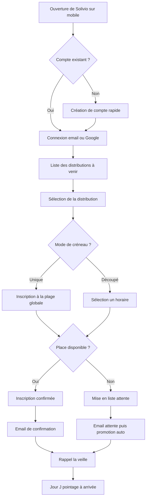

# Parcours utilisateurs - Solivio

> Comment chaque utilisateur vit concrètement le produit, étape par étape, avec la simplicité comme obsession.

**Document structurant - version 1.1**
**Statut : référence de travail**
**Dernière mise à jour : juin 2026**

> Changement depuis la version 1.0 : clarification explicite de l'approche mobile-first et non mobile-only (interface responsive, pleinement utilisable sur ordinateur), avec distinction des parcours à dominante mobile et à dominante ordinateur.

## Avertissement de lecture

Ce document décrit l'expérience concrète des utilisateurs de la V1 : ce qu'ils voient, ce qu'ils font, dans quel ordre, et où se jouent les moments décisifs. Il ne décrit pas la charte graphique (couleurs, typographie, composants), qui vit dans `DESIGN.md` ; la section 12 relie chaque parcours à ses écrans.

Il se limite strictement aux parcours de la V1. Les fonctions repoussées (dons, campagnes, stocks permanents, multi-antennes) n'apparaissent pas, car elles ne font pas partie de l'expérience à concevoir maintenant.

Un fil rouge traverse tout le document, hérité de l'analyse de la concurrence : **le vrai concurrent n'est pas un autre logiciel, c'est le tableur.** Chaque parcours doit donc se mesurer à une seule question : *est-ce plus simple que ce que l'utilisateur fait aujourd'hui ?* Si la réponse n'est pas un oui évident, le parcours est à revoir.

## 1. Le principe directeur : la simplicité

La simplicité n'est pas une qualité parmi d'autres : c'est la condition de survie du produit. Un outil associatif est utilisé par des bénévoles non techniques, dont l'équipe se renouvelle chaque année, souvent dans l'urgence d'un jour de distribution. Un parcours confus n'est pas "moins agréable" : il est abandonné, et l'on retourne au tableur.

Trois conséquences concrètes :

- **Moins d'écrans, moins de clics, moins de champs.** Chaque écran, chaque clic, chaque champ doit justifier son existence. En cas de doute, on retire.
- **Pas de jargon.** Le vocabulaire est celui des utilisateurs, pas celui des développeurs.
- **L'erreur est rattrapable.** Annuler une inscription, corriger une saisie, revenir en arrière doit toujours être facile et sans conséquence grave.

## 2. Principes d'expérience transverses

Ces principes s'appliquent à tous les parcours.

**Mobile d'abord, mais jamais mobile uniquement.** Solivio est conçu selon une approche *mobile-first* : on conçoit pour le téléphone d'abord, puis on enrichit l'affichage pour les écrans plus grands. Mais ce n'est en aucun cas une application *mobile-only* : tous les parcours doivent rester pleinement utilisables sur ordinateur. L'interface est **responsive**, c'est-à-dire qu'elle s'adapte à toutes les tailles d'écran. Concrètement :

- les parcours **à dominante mobile** - l'inscription du bénéficiaire et le pointage sur le terrain le jour J - sont conçus et optimisés d'abord pour le téléphone, car c'est là qu'ils sont réellement utilisés ;
- les parcours **à dominante ordinateur** - la création d'une distribution, la saisie des denrées, le suivi des inscriptions, la configuration de l'association, les statistiques - sont plus riches et plus confortables sur grand écran, où ils sont le plus souvent réalisés, mais doivent rester **entièrement faisables sur mobile** en cas de besoin.

Autrement dit, aucun écran n'est réservé à un seul type d'appareil. Le mobile guide la conception ; l'ordinateur n'est jamais sacrifié.

**Dignité du bénéficiaire.** Le public est en situation de précarité. Le ton, le vocabulaire et le design évitent toute stigmatisation. S'inscrire à une distribution doit être aussi neutre et digne que réserver un créneau quelconque. Aucune mention superflue de la situation sociale n'apparaît dans les parcours visibles par d'autres.

**Confidentialité visible.** La confidentialité n'est pas qu'une protection technique : elle se voit dans l'expérience. Celui qui pointe ne voit qu'un nom et un statut, jamais les données sensibles. Cette retenue est un signal de confiance, autant qu'une exigence.

**Clarté immédiate.** À chaque étape, l'utilisateur sait où il en est, ce qu'il vient de faire, et ce qui se passe ensuite. Une inscription confirmée le dit clairement ; une mise en liste d'attente l'explique sans inquiéter.

**Accessibilité.** Contrastes suffisants, textes lisibles, navigation possible sans souris, compatibilité avec les lecteurs d'écran. Le public est large et divers.

## 3. Les quatre utilisateurs et leurs moments clés

| Utilisateur | Son moment clé | Ce qui compte le plus pour lui |
|---|---|---|
| Bénéficiaire | S'inscrire à une distribution et y être servi | Simplicité, rapidité, dignité |
| Bénévole | S'inscrire à un créneau et aider le jour J | Clarté de ses missions et de son rôle sur place |
| Coordinateur | Organiser une distribution de bout en bout | Vision d'ensemble, calcul de répartition, gestion des imprévus |
| Responsable | Piloter et configurer l'association | Vue globale, statistiques fiables, maîtrise des données |

## 4. Parcours du bénéficiaire

C'est le parcours le plus important et le plus exigeant en simplicité. Il doit être irréprochable sur mobile.

### 4.1 Vue d'ensemble du parcours

### 4.2 Les étapes en détail

**Étape 1 - Accès et compte.** Le bénéficiaire arrive sur Solivio, au nom et au logo de Linkee Toulouse. S'il n'a pas de compte, il en crée un en quelques champs essentiels seulement (identité, contact), sans code ni choix d'association, et indique s'il vient comme bénéficiaire, bénévole, ou les deux. Être bénéficiaire suppose d'être étudiant inscrit et de présenter sa carte étudiante : c'est affiché, et il l'atteste d'une case (RG9). Il se connecte par email et mot de passe, ou avec son compte Google. Plus tard, il peut devenir aussi bénévole depuis son compte, en un geste.

**Étape 2 - Voir les distributions.** Une fois connecté, il voit immédiatement les prochaines distributions auxquelles il peut s'inscrire : date, lieu, et s'il reste de la place. Pas de menu à explorer : l'information utile est en premier.

**Étape 3 - S'inscrire.** Il choisit une distribution. Selon le mode défini par l'association :
- en **mode créneau unique**, il s'inscrit simplement à la plage (par exemple lundi 17h-18h30), en sachant que le service se fera dans l'ordre d'arrivée ;
- en **mode créneaux découpés**, il choisit un horaire précis parmi ceux qui restent (par exemple 16h15-16h30).

**Étape 4 - La confirmation, ou la liste d'attente.** S'il reste de la place, l'inscription est confirmée à l'écran et par email. Si la distribution est complète, il est placé en liste d'attente, ce qui lui est expliqué clairement et sans dramatiser : il sera prévenu automatiquement si une place se libère. S'il a déjà atteint la limite de fréquence fixée par l'association (par exemple une inscription par semaine), l'écran le lui dit avec ménagement.

**Étape 5 - Le rappel.** La veille, il reçoit un email de rappel : date, lieu, et son horaire le cas échéant.

**Étape 6 - Le jour J.** Il se présente. En mode unique, il est servi dans l'ordre d'arrivée ; en mode découpé, à son horaire. Un coordinateur ou un responsable le pointe comme présent. Pour lui, c'est invisible et instantané.

**Étape 7 - Empêchement.** S'il ne peut pas venir, il annule son inscription en un geste, ce qui libère sa place pour la liste d'attente. L'annulation est encouragée et facile, précisément pour réduire les absences.

### 4.3 Ce que le bénéficiaire ne voit jamais

Il ne voit pas les données des autres bénéficiaires, ni les statistiques, ni la logistique. Son espace est minimal : ses inscriptions, à venir et passées, et rien d'autre. Cette minimalité est un choix de simplicité et de confidentialité.

## 5. Parcours du bénévole

### 5.1 S'engager sur un créneau

Le bénévole a choisi ce rôle en créant son compte, ou l'a pris depuis son compte s'il était d'abord bénéficiaire : on peut être les deux, et tenir les deux places à une même distribution (RG9). Une fois connecté, il voit les distributions à venir et les besoins en bénévoles. Il s'inscrit sur un créneau, en indiquant éventuellement un rôle (accueil, logistique). Il reçoit une confirmation, puis un rappel la veille.

### 5.2 Le jour J : aider sur place

C'est le moment fort du bénévole. Il arrive à l'heure de rendez-vous, et le coordinateur lui confie son rôle (accueil, colis, réassort). Il ne pointe pas : depuis octobre 2026, le pointage est réservé aux coordinateurs et aux responsables (RG9), qui tiennent la liste des présences.

**Ce que voit celui qui pointe : le nom et le statut d'inscription. Rien d'autre.** Pas l'âge, pas la situation sociale, pas le reste à vivre. La confidentialité est ici concrète et visible : on a juste ce qu'il faut pour faire son travail, pas davantage.

Un visiteur venu aider sans compte est ajouté à l'équipe du jour. S'il laisse son email, le coordinateur peut lui envoyer le lien pour créer son compte ; ce n'est pas obligatoire.

### 5.3 Se désister

S'il ne peut plus assurer son créneau, il se désinscrit. Si c'est tardif, le coordinateur en est informé, pour pouvoir réagir.

### 5.4 Sa vue d'ensemble

Le bénévole voit ses créneaux à venir et son historique de participation. Simple, centré sur lui.

## 6. Parcours du coordinateur

C'est le parcours le plus riche, car le coordinateur orchestre la distribution. Il doit rester maîtrisable malgré sa richesse.

### 6.1 Créer une distribution

Le coordinateur crée une distribution en renseignant l'essentiel : titre, date, lieu, description. Il choisit le **mode de créneau** :
- **créneau unique** : une seule plage, service dans l'ordre d'arrivée ;
- **créneaux découpés** : il définit des plages successives (par exemple toutes les 15 minutes), chacune avec sa capacité.

Il fixe les capacités (nombre de bénéficiaires, nombre de bénévoles). La distribution est d'abord en brouillon ; il la publie quand elle est prête, ce qui la rend visible pour les inscriptions.

### 6.2 Saisir les denrées et voir la répartition

C'est une étape distinctive de Solivio. Le coordinateur saisit les denrées disponibles **en conditionnement** : pour chaque denrée, un libellé, une unité, un nombre de contenants et une quantité par contenant. L'application calcule aussitôt la quantité totale.

Puis elle affiche, pour chaque denrée, la **dotation par bénéficiaire** : la quantité totale divisée par le nombre d'inscrits, arrondie à l'inférieur, avec un plancher à 1. Exemple à l'écran : "Pommes de terre : 10 sacs x 100 = 1 000, soit 10 par personne pour 100 inscrits".

Le cas de pénurie est rendu clair : si une denrée ne suffit pas pour tout le monde (par exemple 50 yaourts pour 100 inscrits), l'application affiche "1 par personne, pour 50 bénéficiaires sur 100". Elle ne masque pas le manque ; elle le montre, pour que le coordinateur prépare en conséquence.

Le coordinateur peut basculer la base de calcul des inscrits vers les présents, utile le jour J pour ajuster un reste à ceux qui sont effectivement venus.

### 6.3 Suivre les inscriptions

Avant la distribution, le coordinateur voit en temps réel le remplissage : inscrits confirmés, places restantes, liste d'attente. Il peut inscrire ou désinscrire quelqu'un manuellement si besoin. Cette vue est sa source de vérité, celle qui remplace les multiples onglets de tableur.

Son accueil tient une liste "À faire" : une distribution restée en cours après sa date (à clore), un brouillon à venir (à publier), une distribution publiée à 7 jours ou moins remplie à moins de la moitié de ses places bénéficiaires ("Peu d'inscrits"), et une distribution publiée à 14 jours ou moins à laquelle il manque des bénévoles.

### 6.4 Le jour J

Le coordinateur pointe les présences, avec les responsables présents, suit en direct qui est présent, et dispose de la répartition à jour. Tout est sur un seul écran, pensé pour l'action sous pression.

### 6.5 Gérer les imprévus

- **Annuler une distribution** : en quelques gestes, avec un motif. Tous les inscrits, bénéficiaires et bénévoles, sont prévenus automatiquement par email. Personne ne se déplace pour rien.
- **Gérer un désistement bénévole tardif** : il en est informé et peut réagir.

### 6.6 Clôturer

Après la distribution, le coordinateur la clôt. Il dispose alors d'un bilan : combien d'inscrits, de présents, d'absents, quelle répartition a été appliquée. Ce bilan nourrit les statistiques.

## 7. Parcours du responsable

### 7.1 Configurer l'association

À la mise en place, le responsable renseigne l'identité de l'association : nom et logo. Il définit aussi les paramètres de base : contact et fréquence d'inscription. Les couleurs suivent le système de design et le fuseau est celui de Toulouse ; ni l'un ni l'autre ne se règle.

### 7.2 Gérer les membres et les rôles

Chacun choisit seul d'être bénévole, bénéficiaire ou les deux. Le responsable ajoute ou retire ces rôles et celui de coordinateur depuis la fiche d'un membre, qui peut les cumuler (un coordinateur peut aussi être bénévole et bénéficiaire). Il peut nommer un membre responsable : ce rôle ne se cumule avec aucun autre, et ne se donne qu'une fois les inscriptions à venir de la personne passées ou annulées. Il n'invite plus qu'une personne sans compte appelée à devenir responsable (RG9).

### 7.3 Suivre l'activité

Le responsable dispose d'un tableau de bord de statistiques agrégées : nombre de distributions sur une période, bénéficiaires distincts servis, bénévoles mobilisés, taux de présence. Les chiffres sont présentés simplement, et toujours de façon agrégée : on compte, on n'expose pas les individus.

### 7.4 Maîtriser les données

Le responsable peut exporter l'ensemble des données de l'association, et en demander la suppression. C'est la traduction concrète, dans l'expérience, de la promesse de non-enfermement. Cette possibilité est visible et accessible, pas cachée.

## 8. Les moments de vérité

Certains instants décident de l'adoption ou de l'abandon. Ils méritent un soin particulier.

| Moment de vérité | Pourquoi il est décisif | Exigence |
|---|---|---|
| La première inscription d'un bénéficiaire | S'il galère, il abandonne et l'asso revient au formulaire | Doit se faire en moins d'une minute sur mobile |
| Le pointage le jour J | Sous pression, avec du monde qui attend | Doit être instantané et fonctionner même sur une connexion faible |
| La saisie des denrées et le calcul de répartition | C'est la valeur unique de Solivio | Le calcul doit être immédiat et limpide, le cas de pénurie clair |
| L'annulation d'une distribution | Un raté ici, et des gens se déplacent pour rien | La notification automatique doit être fiable à 100 % |
| La reprise par un nouveau bureau | C'est là que meurent les outils associatifs | L'outil doit être compréhensible sans formation longue |

Le dernier point dépasse le cadre strict de la V1 mais doit rester présent à l'esprit : la simplicité de chaque parcours est ce qui permettra à un nouveau bureau de reprendre l'outil sans tout réapprendre.

## 9. Ce qui est volontairement absent des parcours V1

Pour rester cohérent avec le périmètre, ces parcours n'existent pas en V1 :

- gérer un stock permanent (seule la répartition ponctuelle existe) ;
- enregistrer des dons ou gérer des donateurs ;
- créer des campagnes ;
- gérer des antennes et une hiérarchie ;
- composer des modèles de messages personnalisés ou des messages ciblés plus finement que par rôle ;
- s'inscrire en tant que nouvelle association en autonomie.

Ces absences sont des choix, pas des oublis.

## 10. Ce que ce document implique pour la suite

- La **roadmap** (`roadmap.md`) doit prioriser les parcours dans l'ordre de leur criticité : d'abord l'inscription du bénéficiaire et le pointage, puis la création de distribution et la répartition, puis la configuration et les statistiques.
- La phase de **design visuel** (au moment du développement frontend, guidée par les bonnes pratiques d'interface) traduira ces parcours en écrans concrets, en gardant la simplicité comme critère premier.
- Les **tests fonctionnels** définis dans l'architecture doivent couvrir en priorité les moments de vérité de la section 8.

## 11. Synthèse en une page

**Le principe.** La simplicité avant tout, mesurée contre le tableur : si ce n'est pas plus simple que ce que l'utilisateur fait aujourd'hui, c'est à revoir.

**Le bénéficiaire.** Un parcours mobile, digne et minimal : voir les distributions, s'inscrire en moins d'une minute, recevoir confirmation et rappel, être pointé sans friction le jour J, annuler facilement. Il ne voit que ses propres inscriptions.

**Le bénévole.** S'inscrire à un créneau et aider le jour J, à son rôle ; il peut aussi être bénéficiaire. Le pointage revient aux coordinateurs et responsables, qui ne voient qu'un nom et un statut, jamais les données sensibles. La confidentialité rendue visible.

**Le coordinateur.** Le parcours le plus riche : créer une distribution avec son mode de créneau, saisir les denrées en conditionnement et voir la répartition calculée (avec le cas de pénurie affiché clairement), suivre les inscriptions, superviser le jour J, gérer les imprévus, clôturer.

**Le responsable.** Configurer l'association, gérer membres et rôles, suivre des statistiques agrégées, et exporter ou supprimer les données - le non-enfermement rendu concret.

**Les moments de vérité.** Première inscription, pointage, calcul de répartition, annulation, reprise par un nouveau bureau. C'est là que se joue l'adoption, et c'est là que la simplicité doit être irréprochable.

## 12. Écrans de la V1 (refonte d'octobre 2026)

La navigation compte quatre entrées au plus sur téléphone (barre basse) et se groupe par intention sur ordinateur. Chaque objet a une seule page qui suit son cycle de vie, avec une action principale et les actions rares dans un menu "Plus".

| Rôle | Écrans | Adresses |
|---|---|---|
| Visiteur | Accueil de Linkee Toulouse avec les prochaines distributions, création de compte, connexion, mot de passe oublié | `/`, `/register`, `/login`, `/forgot-password` |
| Bénéficiaire | Accueil (billet du prochain rendez-vous), Agenda par semaine, fiche d'une distribution avec choix du créneau, Mes inscriptions, Compte (mes rôles, devenir aussi bénévole) et dossier social | `/dashboard`, `/distributions`, `/distributions/{id}`, `/mes-inscriptions`, `/mon-compte` |
| Bénévole | Les mêmes (une personne bénévole et bénéficiaire réserve les deux places depuis la fiche), plus "On a besoin de vous", Mes engagements (distributions, missions, événements, sessions), missions de collecte, événements et reconditionnement | `/missions-collecte`, `/evenements`, `/reconditionnement` |
| Coordinateur | Aujourd'hui et sa liste "À faire", Planning, feuille d'une distribution (vue d'ensemble, inscrits, équipe, denrées, bilan), création et duplication, Jour J en plein écran, répartition et fiche stand, statistiques, rôles bénévoles | `/distributions/nouvelle`, `/distributions/{id}/pointage`, `/distributions/{id}/repartition`, `/statistiques`, `/association/roles-benevoles` |
| Responsable | Les mêmes, plus membres (rôles cumulables, nommer responsable, inviter un futur responsable), réglages et export, catalogue des denrées, message aux membres, création des activités | `/association/membres`, `/association/configuration`, `/association/catalogue-denrees`, `/notifications/email-libre` |
| Super admin | Administration des comptes | `/admin/utilisateurs` |

Seuils de la liste "À faire" : voir la section 6.3.

*Fin des parcours utilisateurs. Document suivant : `roadmap.md`.*
