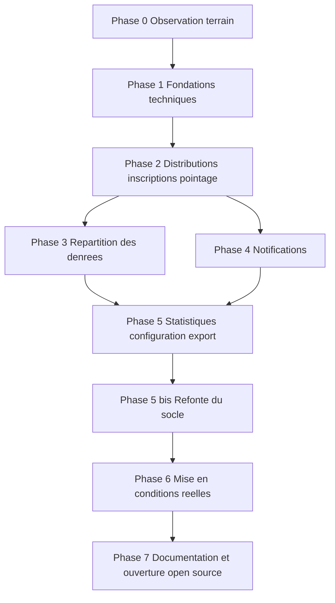

# Roadmap - Solivio

> Quoi construire, dans quel ordre, et pourquoi : le plan d'exécution qui ordonne toutes les décisions de la série.

**Document de pilotage - version 1.3**
**Statut : référence de travail**
**Dernière mise à jour : octobre 2026**

> Changement depuis la version 1.2 : la phase 5 bis (refonte du socle) est terminée ; Solivio tourne en préproduction et en production sur le VPS, observé et sauvegardé. Prochaine étape : la phase 6, mise en conditions réelles.
>
> Rappel de la version 1.2 : les phases 2 à 5 sont livrées (juin 2026) et Solivio sert uniquement Linkee Toulouse. Les descriptions des phases 1 et 4 restent comme historique : Keycloak, Kafka, OpenBao et le multi-association qu'elles mentionnent sont retirés (`architecture_technique.md`, section 14).

## Avertissement de lecture

Ce document est le plan d'exécution. Il ne réintroduit aucune décision nouvelle : il ordonne dans le temps ce que les autres documents ont défini. Si une priorité ici contredit un document fondateur ou structurant, c'est ce document qui a tort.

Deux mises au point essentielles, héritées de l'étude de faisabilité :

1. **L'ordre compte plus que les dates.** Les durées indiquées sont des ordres de grandeur, pas des engagements. Le calendrier réel dépend du temps disponible, qui est la ressource rare du projet. Ce qui est ferme, c'est la **séquence** et le **périmètre**, pas le nombre de semaines.

2. **La fenêtre de disponibilité est maintenant.** Contre l'intuition, le temps disponible va probablement diminuer avec la prise de poste, pas augmenter. Les fondations lourdes - celles qui n'apportent rien de visible mais conditionnent tout - doivent donc être posées pendant la période de plus forte disponibilité, c'est-à-dire le plus tôt possible. Ce qui vient après peut avancer par petites touches.

## 1. Les principes qui gouvernent l'ordre

**O1 - Les fondations d'abord, même invisibles.** Le socle multi-association, l'authentification, la conteneurisation, l'isolation : rien de tout cela ne se voit, mais tout repose dessus. On le construit avant les fonctionnalités, pendant la fenêtre de disponibilité.

**O2 - Le préalable terrain est non négociable.** Avant la moindre ligne de code, on observe l'association pilote. C'est la condition encore non remplie pointée par l'étude de faisabilité, et la moins coûteuse à lever.

**O3 - Le premier incrément utile le plus tôt possible.** Après les fondations, on vise rapidement la première tranche réellement utilisable par le pilote (inscription et pointage), pour obtenir du retour réel et de la motivation.

**O4 - Incréments courts et livrables.** Chaque phase produit quelque chose de cohérent et testable. Pas de chantier de plusieurs mois sans rien de montrable.

**O5 - Le périmètre V1 est verrouillé.** La roadmap construit exactement les neuf points de la V1 définis dans les spécifications, plus ce qui y a été intégré en octobre 2026 et déjà livré : les trois modules complémentaires (événements, missions de collecte, sessions de reconditionnement, section 4.10) et le message aux membres (section 4.8). Rien d'autre. Toute idée nouvelle va dans la réserve d'après-V1, pas dans le plan.

**O6 - La documentation est un livrable.** Conformément au modèle économique, la documentation d'installation et d'usage n'est pas une corvée de fin de projet : c'est ce qui rend l'auto-hébergement et la pérennité possibles.

## 2. Vue d'ensemble des phases

| Phase | Objet | Visible par l'utilisateur ? | Charge |
|---|---|---|---|
| 0 | Observation terrain | Non (préalable) | Légère |
| 1 | Fondations techniques | Non | Lourde |
| 2 | Distributions, inscriptions, pointage | Oui (premier usage) | Lourde |
| 3 | Répartition des denrées | Oui | Moyenne |
| 4 | Notifications email | Oui | Moyenne |
| 5 | Statistiques, configuration, export | Oui | Moyenne |
| 5 bis | Refonte du socle pour une association unique | Non | Lourde |
| 6 | Mise en conditions réelles | Oui | Moyenne |
| 7 | Documentation et open source | Oui (externe) | Moyenne |

## 3. Phase 0 - Observation terrain (préalable) - COMPLETE

**Objectif.** Confirmer que le besoin est réel et bien compris, avant d'écrire du code.

**Ce qu'on fait.** Passer du temps avec l'association pilote pour observer comment elle gère réellement une distribution aujourd'hui : quels outils, quels fichiers, quels messages, où elle perd du temps, ce qui l'agace. Valider que les parcours imaginés correspondent à la réalité, en particulier la mécanique des créneaux et le calcul de répartition.

**Critère de sortie.** On sait précisément quel point de douleur Solivio résout en premier, et on a confirmé (ou corrigé) les hypothèses des spécifications.

**Pourquoi c'est en premier.** C'est quelques heures d'investissement qui peuvent éviter des mois de travail sur le mauvais problème. C'est le meilleur rapport valeur/effort de tout le projet.

## 4. Phase 1 - Fondations techniques - COMPLETE (juin 2026)

**Objectif.** Poser le socle invisible sur lequel tout reposera. À faire pendant la fenêtre de disponibilité maximale.

**Ce qu'on construit :**

- l'environnement conteneurisé complet (Docker Compose) réunissant backend, frontend, PostgreSQL, Keycloak, Kafka, OpenBao, pour développer en conditions proches de la production ;
- le squelette du backend Spring Boot avec sa structure en modules (frontières posées dès le départ, même si les modules sont encore vides) ;
- le squelette du frontend Next.js avec le contexte d'association et l'intégration de connexion via Keycloak ;
- le mécanisme d'**isolation multi-association** (un schéma par association, résolution du contexte à chaque requête) ;
- la **suite de tests d'isolation**, écrite tôt, qui vérifie qu'aucune association ne peut accéder aux données d'une autre ;
- l'identité et l'accès de base : personne, rôle, affiliation, connexion ;
- le journal d'audit ;
- la gestion des secrets via OpenBao ;
- le pipeline GitLab CI/CD (analyse, tests, construction, migrations, déploiement).

**Critère de sortie atteint.** L'application demarre, les associations sont isolees par schema PostgreSQL (suite de tests d'isolation validee), la connexion via Keycloak fonctionne en mode BFF stateless (tokens chiffres en cookies HttpOnly), le provisioning JIT cree la Personne au premier appel authentifie, et la CI GitLab passe au vert. Les fondations sont en place, Phase 2 peut commencer.

**Ce qui a ete construit en plus des previsions initiales :** BFF stateless complet (Spring Boot OAuth2 Client + Resource Server, cookies AES-256-GCM), support dual-client browser/Capacitor (CompositeBearerTokenResolver), CORS configurable, CSRF spa(), cle de chiffrement depuis OpenBao, realm Keycloak versionne (keycloak/realm-solivio.json).

**Risque principal.** La tentation d'abandonner faute de résultat visible. La parade : se rappeler que c'est cette phase qui rend tout le reste possible, et qu'elle est le meilleur usage de la fenêtre de disponibilité actuelle.

## 5. Phase 2 - Distributions, inscriptions et pointage

**Objectif.** Livrer la première tranche réellement utilisable : le cœur du produit, et les parcours les plus critiques.

**Ce qu'on construit :**

- la création et la gestion d'une distribution par le coordinateur, avec les deux modes de créneau (unique premier-arrivé-premier-servi, ou découpé par horaire) et les capacités ;
- la publication et l'annulation d'une distribution ;
- l'inscription des bénéficiaires, avec la liste d'attente et la promotion automatique, et les règles de fréquence ;
- l'inscription des bénévoles sur les créneaux, avec rôle ;
- le pointage le jour J, dans le respect de la confidentialité (le bénévole ne voit que nom et statut) ;
- le suivi en temps réel du remplissage par le coordinateur.

**Critère de sortie.** L'association pilote peut, en théorie, gérer une distribution de bout en bout : créer, faire inscrire, pointer. C'est le premier moment où Solivio existe vraiment.

**Pourquoi cet ordre.** Une distribution doit exister avant qu'on puisse s'y inscrire ; une inscription avant qu'on puisse pointer. Et ce sont les parcours désignés comme les plus critiques par le document des parcours utilisateurs.

## 6. Phase 3 - Répartition des denrées

**Objectif.** Ajouter la fonction distinctive de Solivio, celle qu'aucun concurrent n'offre.

**Ce qu'on construit :**

- la saisie des denrées d'une distribution en conditionnement (nombre de contenants x quantité par contenant), avec calcul automatique du total ;
- le calcul de la dotation par bénéficiaire (division par les inscrits ou les présents, arrondi à l'inférieur, plancher à 1) ;
- l'affichage clair du reste et du cas de pénurie ("1 par personne pour X bénéficiaires sur Y").

**Critère de sortie.** Le coordinateur peut, le jour de la distribution, saisir ce qui est disponible et savoir immédiatement combien donner par personne. C'est la valeur unique du produit, livrée.

**Pourquoi après la phase 2.** La répartition s'appuie sur les distributions et le nombre d'inscrits ou de présents, qui doivent exister d'abord.

## 7. Phase 4 - Notifications

**Objectif.** Automatiser les communications, via le socle événementiel (Kafka à l'origine, remplacé par les événements internes Spring Modulith en phase 5 bis).

**Ce qu'on construit :**

- l'émission d'événements aux moments clés (inscription confirmée, distribution annulée, promotion depuis la liste d'attente) ;
- le module de notification qui consomme ces événements et envoie les emails ;
- les envois automatiques : confirmation, rappel la veille, annulation, promotion.

**Critère de sortie.** Plus aucun rappel ni aucune annulation ne se fait à la main. C'est aussi le premier vrai usage de Kafka, et le module candidat à une future extraction en microservice.

**Pourquoi en parallèle possible de la phase 3.** Les notifications dépendent des inscriptions et distributions (phase 2), mais pas de la répartition (phase 3). Les phases 3 et 4 peuvent donc s'enchaîner dans l'ordre le plus motivant, sans dépendance entre elles.

## 8. Phase 5 - Statistiques, configuration et maîtrise des données

**Objectif.** Donner au responsable la vue d'ensemble et la maîtrise de son association.

**Ce qu'on construit :**

- les statistiques de base, agrégées et pseudonymisées (distributions, bénéficiaires distincts, bénévoles, taux de présence) ;
- la configuration de l'association (nom, logo, couleurs, paramètres) ;
- la gestion des membres et de leurs rôles par le responsable ;
- l'export complet et la suppression des données de l'association (non-enfermement).

**Critère de sortie.** Le responsable peut configurer son association, piloter par les chiffres, et exercer son droit d'export et de suppression. La V1 est alors fonctionnellement complète.

## 8 bis. Phase 5 bis - Refonte du socle (octobre 2026) - COMPLETE

**Objectif.** Partir d'une base simple et solide avant la mise en conditions réelles, maintenant que Solivio ne sert plus que Linkee Toulouse.

**Contenu.** Dans l'ordre, une branche et une demande de fusion par étape :

1. Règles et documentation : `CLAUDE.md` réécrits sur le modèle des projets de référence, architecture version 2.0 avec ADR, documents alignés sur l'association unique.
2. Retrait d'OpenBao : secrets par variables d'environnement, injectés par Infisical.
3. Retrait du multi-tenant : un seul schéma, une migration Flyway de base neuve, configuration d'association unique.
4. Spring Modulith : vérification des frontières de modules, événements internes avec registre de publication à la place de Kafka.
5. Durcissement de l'authentification : limitation de débit, verrouillage, politique de mot de passe, en-têtes de proxy.
6. Observabilité et exploitation : journaux JSON, métriques, traces, sauvegardes.
7. Conteneurs, compose et CI/CD GitHub Actions ; `dev` vers la préproduction, `main` vers la production.
8. Intégration au dépôt `infrastructure` du VPS : collecte, tableaux de bord, alertes.
9. Nettoyage du frontend (choix d'association, administration des associations).
10. Gel de l'application mobile Expo, ruptures d'API documentées.
11. Audit final : couverture, typographie, secrets, dépendances.

**Critère de sortie.** Plus aucune mention de tenant, Kafka, OpenBao ou Keycloak dans le code ; tests verts, couverture d'au moins 80 pour cent, test de modularité vert ; application déployée en préproduction sur le VPS et visible dans Grafana.

**Critère de sortie atteint (9 octobre 2026).** Les onze étapes sont fusionnées. Au-delà du critère initial :

- dépôt migré de GitLab vers GitHub (historique, branches et demandes de fusion, devenues les PR #1 à #32) ; intégration continue sur GitHub Actions avec analyse des dépendances (OSV-Scanner, `npm audit`), détection de secrets et Dependabot ;
- **préproduction** sur `https://staging.solivio.joeltech.fr` (branche `dev`) et **production** sur `https://solivio.joeltech.fr` (branche `main`), déployées par la CI, secrets dans Infisical, emails par Brevo ;
- observabilité vérifiée : métriques des deux environnements dans Prometheus, journaux dans Loki, tableau de bord "Solivio - Application", six alertes de production, moniteurs Uptime Kuma (PostgreSQL, sites, sauvegardes) ;
- sauvegardes quotidiennes chiffrées vers Cloudflare R2 par un service dédié (ADR-009), premier test de restauration réussi le 8 octobre 2026 (`docker/backup/README.md`) ;
- déploiement sans coupure par `docker-rollout` derrière Traefik (ADR-010).

La clé Google Maps et le secret client Google publiés dans l'historique du dépôt ont été révoqués.

**Reste ouvert, à traiter au fil de la phase 6 :**

- tester dans le navigateur, en préproduction puis en production, l'inscription (email reçu par Brevo), la connexion et la connexion Google ;
- ajouter une distribution aux données de test, pour que le parcours Playwright de répartition s'exécute en intégration continue.

**Décision (9 octobre 2026) : le web d'abord.** L'application mobile reste en suspens (ADR-007), avec ses ruptures d'API connues. L'effort porte sur le frontend web, rendu pleinement responsive pour servir aussi sur téléphone, en priorité l'inscription et le pointage (exigence mobile d'abord des spécifications).

## 9. Phase 6 - Mise en conditions réelles

**Objectif.** Confronter la V1 au terrain, et corriger sur la base du réel.

**Ce qu'on fait :**

- déployer pour l'association pilote ;
- l'utiliser sur plusieurs distributions consécutives ;
- recueillir le retour de façon systématique - non pas "c'est bien ?" mais "qu'est-ce qui te fait perdre du temps ?" ;
- corriger les frictions, en priorité sur les moments de vérité (première inscription, pointage, répartition, annulation).

**Critère de sortie.** L'association utilise Solivio en routine et y trouve un gain de temps réel par rapport à sa méthode précédente. C'est l'objectif à court terme de la note d'intention, atteint.

## 10. Phase 7 - Documentation et ouverture open source

**Objectif.** Rendre le projet pérenne et partageable.

**Ce qu'on produit :**

- la documentation d'installation et d'exploitation pour l'auto-hébergement (pilier de pérennité du modèle économique) ;
- des guides d'usage courts par rôle (responsable, coordinateur, bénévole, bénéficiaire) ;
- la publication du code sous licence AGPL, avec les éléments d'accueil d'un projet open source (description, conditions de contribution) ;
- les conditions d'utilisation et l'accord de sous-traitance type (avec, le moment venu, l'appui juridique évoqué dans l'étude de faisabilité).

**Critère de sortie.** Une autre personne pourrait installer Solivio à partir de la documentation, et le projet survit à son auteur. La promesse de non-enfermement et de pérennité est tenue.

## 11. Au-delà de la V1 : l'horizon

Rien de ceci ne se construit avant que la V1 ait prouvé sa valeur en conditions réelles (phase 6). L'ordre ci-dessous est indicatif et sera arbitré à la lumière du retour terrain.

**Horizon V2 (renforcer et commencer à généraliser) :**

- gestion des stocks permanents, branchée sur la répartition ;
- gestion des dons et connexion à la plateforme de collecte externe ;
- configurabilité étendue (champs, types, modèles de messages) - premier vrai pas vers d'autres associations ;
- statistiques avancées et exports pour les financeurs ;
- notifications multicanal (SMS, push) et messages ciblés plus finement que par rôle ;
- onboarding d'une deuxième association pilote, au fonctionnement différent, pour valider la généricité.

**Horizon V3 (devenir une plateforme) :**

- moteur de workflow configurable ;
- constructeur de formulaires ;
- hiérarchie multi-antennes (dont la structure est déjà anticipée dans le modèle de données) ;
- interface de programmation et webhooks ;
- campagnes ;
- première extraction d'un microservice (le module Notifications), comme exercice délibéré sur une base stable.

## 12. Points de contrôle et règles de pilotage

**Après chaque phase, un point de contrôle.** On se pose trois questions : la phase a-t-elle atteint son critère de sortie ? le périmètre a-t-il dérivé ? le rythme est-il tenable sans épuisement ?

**La règle d'arrêt face à une idée nouvelle.** Toute fonctionnalité non prévue va dans la réserve d'après-V1. On ne l'ajoute au plan que si elle est jugée indispensable à la V1, ce qui doit rester exceptionnel. La répartition des denrées, ajoutée en cours de route, est l'exception qui confirme la règle : elle a été acceptée parce qu'elle relève d'un besoin opérationnel réel et central, après examen explicite.

**Le signal d'alerte à surveiller.** Si plusieurs semaines passent sans progrès ni motivation, ce n'est pas un problème de volonté mais de découpage : il faut alors réduire encore la taille de l'incrément en cours, jusqu'à retrouver un pas franchissable.

## 13. Synthèse en une page

**La séquence.** Observer le terrain, poser les fondations invisibles pendant la fenêtre de disponibilité, livrer le cœur (distributions, inscriptions, pointage), ajouter la répartition des denrées, automatiser les notifications, compléter par les statistiques et la configuration, confronter au réel, puis documenter et ouvrir le code.

**La règle d'or.** L'ordre et le périmètre sont fermes ; les dates ne le sont pas. Le calendrier suit le temps disponible, qui est la ressource rare.

**Le contre-pied stratégique.** Faire le plus lourd maintenant, tant que le temps est là, parce qu'il se raréfiera avec la prise de poste.

**Le verrou.** La V1, ce sont neuf points et les ajouts déjà livrés d'octobre 2026 (règle O5), pas un de plus. Toute idée nouvelle attend l'après-V1.

**La pérennité.** La documentation et l'open source ne sont pas la fin du projet : ils sont ce qui lui permet de survivre à son auteur.

**Le cap.** On ne généralise vers la plateforme qu'après avoir réussi pour une seule association. Réussir petit d'abord, grandir ensuite.

*Fin de la roadmap. Document suivant et dernier : `glossaire.md`.*
